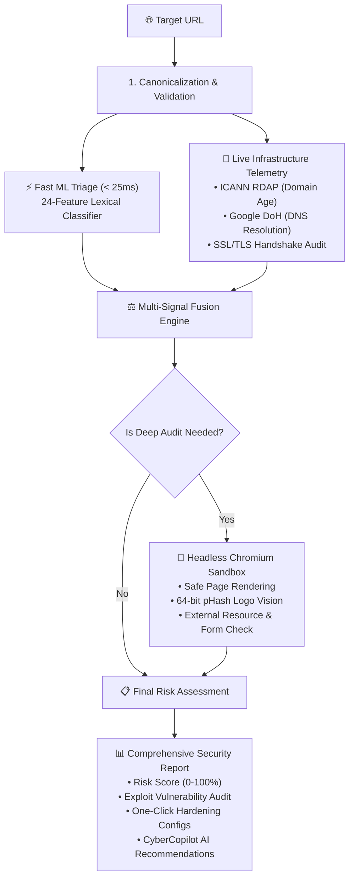

# 🛡️ CyberGuard AI (v2.0-SOC PRO)
> **Real-Time Multi-Modal Phishing Intelligence, Website Hardening & Threat Telemetry Platform**  
> *100% Free & Open Access • Live Telemetry (Zero Synthetic Data) • Zero Paywalls*

<div align="center">

[](https://fastapi.tiangolo.com)
[](https://react.dev)
[](https://www.typescriptlang.org)
[](https://tailwindcss.com)
[](https://playwright.dev)
[](https://scikit-learn.org)
[](https://developer.chrome.com/docs/extensions/)
[](#)

</div>

---

## ⚡ What is CyberGuard AI in 30 Seconds?

**CyberGuard AI** is a modern cybersecurity platform built to detect zero-day phishing, credential-harvesting kits, and website vulnerabilities in real time. 

Traditional security tools rely on outdated static blacklists that take days to update. Attackers know this—most phishing domains live for less than 4 hours. CyberGuard AI solves this with **multi-modal real-time triage**:

1. **Sub-25ms Lexical ML Engine**: Analyzes 24 structural domain features before network overhead.
2. **Live Network Telemetry**: Direct queries to ICANN RDAP (registration age), Google DNS-over-HTTPS (DoH), and cryptographic SSL/TLS verification.
3. **Visual Brand Impersonation Vision**: Headless Chromium sandbox captures target pages and uses **64-bit Perceptual Hashing (pHash)** to detect pixel-level impersonation of protected brands (Google, Microsoft, PayPal, Steam, etc.).
4. **Developer Website Hardening**: Scans HTTP headers and DNS records, instantly generating drop-in security configurations for **Nginx, Apache, Next.js, Node.js Helmet, and Cloudflare**.
5. **CyberCopilot AI**: An integrated conversational cybersecurity assistant that explains threats, suggests countermeasures, and guides vulnerability fixes.
6. **100% Free & Open Access**: No subscriptions, no mandatory wallets, and no hidden paywalls.

---

## 🚀 Quick Navigation

- [Key Features](#-key-features)
- [How It Works (System Architecture)](#-how-it-works-system-architecture)
- [SOC & Developer Security Suite](#-soc--developer-security-suite)
- [Getting Started & Local Setup](#-getting-started--local-setup)
- [API Reference Cheatsheet](#-api-reference-cheatsheet)
- [Manifest V3 Chrome Extension](#-manifest-v3-chrome-extension)
- [Tech Stack](#-tech-stack)

---

## 🎯 Key Features

### 1. 🛡️ Live Threat Scanner (Dual-Persona)
- **End-User / SOC Mode**: Evaluates incoming URLs, computes risk scores (0-100%), and classifies verdicts (`BENIGN`, `SUSPICIOUS`, `PHISHING`, `UNREGISTERED`).
- **Webmaster / Developer Mode**: Audits HTTP response headers (`CSP`, `HSTS`, `X-Frame-Options`, `Permissions-Policy`), TLS protocol/cipher strength, and email security (`SPF`, `DMARC`, `DKIM`).

### 2. 👁️ Computer Vision & Logo Matcher (pHash)
- Runs an isolated Playwright Chromium instance to render pages safely.
- Computes perceptual image hashes (pHash) against canonical enterprise brand logos.
- Flags **Brand-Domain Contradictions**—e.g., when a page visually appears identical to PayPal or Microsoft 365, but runs on an unrelated domain.

### 3. 🤖 CyberCopilot AI Assistant
- Context-aware conversational security advisor.
- Understands your latest scan results and answers questions on threat mechanics, exploit mitigation, and web application hardening.
- Supports multi-turn dialogue with scoped session history.

### 4. 🧩 Manifest V3 Chrome Extension
- Lightweight browser defense that runs in the background.
- Scans URLs as you browse or via an easy popup badge.
- Instant alert badges before entering untrusted credentials.

---

## 🔬 How It Works (System Architecture)



---

## 🛠️ SOC & Developer Security Suite

Beyond single-URL scanning, CyberGuard AI includes a full defensive toolkit:

| Tool | Description |
| :--- | :--- |
| **📧 Email Link Extractor** | Paste raw email body/HTML to extract and scan all embedded hyperlinks for phishing lures simultaneously. |
| **🔗 Bulk URL Scanner** | Scan up to 20 URLs concurrently with live progress, batch metrics, and CSV export. |
| **📊 Threat Intel Dashboard** | Real-time global telemetry: scan volume, top impersonated brands, high-risk TLD distributions, and recent alerts. |
| **🔐 Password & Breach Checker** | Evaluates password entropy and estimates crack times. Uses **k-Anonymity SHA-1** via HaveIBeenPwned—your password is never exposed. |
| **🌍 IP & ASN Reputation** | Queries IP geolocation, Autonomous System Numbers (ASN), hosting provider tags, proxy/VPN/Tor flags, and reverse DNS. |
| **🔔 Domain Watchlist** | Monitor mission-critical domains, track historical risk status, and trigger ad-hoc re-scans. |
| **🛡️ Exploit Immunity Generator** | Instant drop-in security header configs for Nginx, Apache, Next.js, Node.js Helmet, and Cloudflare. |

---

## 💻 Getting Started & Local Setup

### Prerequisites
- **Python 3.10+**
- **Node.js 18+** & **npm**
- **Git**

---

### Step 1: Clone the Repository
```bash
git clone https://github.com/Siddharth-Singh-Chouhan/cyberAI.git
cd cyberAI
```

---

### Step 2: Start the Backend (FastAPI)
```bash
# Navigate to backend and create virtual environment
cd backend
python3 -m venv venv
source venv/bin/activate  # On Windows: venv\Scripts\activate

# Install dependencies
pip install -r requirements.txt

# Install Playwright browser binaries
playwright install chromium

# Launch the FastAPI server
python3 -m uvicorn app.main:app --host 127.0.0.1 --port 8000 --reload
```
*The backend API will be live at `http://127.0.0.1:8000` (API Docs at `http://127.0.0.1:8000/docs`).*

---

### Step 3: Start the Frontend (React + Vite)
```bash
# In a new terminal, navigate to the frontend
cd frontend

# Install packages
npm install

# Start Vite development server
npm run dev
```
*Open `http://localhost:5173` in your browser.*

---

## 🧩 Manifest V3 Chrome Extension Setup

Protect your browsing in real time:

1. Open Google Chrome (or Chromium-based browser) and navigate to `chrome://extensions/`.
2. Toggle on **Developer mode** in the top-right corner.
3. Click **Load unpacked**.
4. Select the `extension/` folder inside this repository:
   ```
   cyberAI/extension
   ```
5. The **CyberGuard AI Shield** icon will appear in your Chrome toolbar. Ensure your local backend is running at `http://127.0.0.1:8000`.

---

## 📡 API Reference Cheatsheet

### Core Endpoints

| Method | Endpoint | Description |
| :--- | :--- | :--- |
| `POST` | `/api/scan/free` | Primary triage scan (ML lexical features, RDAP, DoH, TLS audit) |
| `POST` | `/api/scan/deep` | Deep forensic scan (Headless Chromium, pHash brand vision, DOM checks) |
| `POST` | `/api/scan/bulk` | Parallel scanning of up to 20 URLs simultaneously |
| `GET` | `/api/threat/stats` | Aggregated threat stats (top brands, risky TLDs, recent flags) |
| `POST` | `/api/chat` | Contextual CyberCopilot AI conversation endpoint |
| `POST` | `/api/tools/password-strength` | Password entropy calculation and k-Anonymity breach check |
| `POST` | `/api/tools/ip-reputation` | IP address geolocation, ASN carrier, proxy/VPN/Tor classification |
| `POST` | `/api/tools/screenshot` | Headless sandbox screenshot of target webpage |
| `GET` | `/api/watchlist` | Retrieve saved domain watchlist |
| `POST` | `/api/watchlist` | Add a domain to monitor |
| `DELETE`| `/api/watchlist/{id}` | Remove a domain from watchlist |

---

## 🧱 Tech Stack

### Frontend
- **React 19** with **TypeScript 5.9** & **Vite**
- **Tailwind CSS** with Glassmorphism UI & Dual Theme (Dark / Light)
- **Framer Motion** for smooth cyber-HUD micro-interactions
- **Lucide Icons**

### Backend & AI
- **FastAPI (Python 3.11)** with asynchronous request pipeline
- **Scikit-Learn Random Forest Classifier** trained on lexical feature sets
- **Playwright (Headless Chromium)** for dynamic sandbox execution
- **ImageHash & Pillow** for 64-bit perceptual hashing (`pHash`)
- **Cryptography & PyOpenSSL** for real-time TLS handshake verification
- **Google DNS-over-HTTPS (DoH)** & **ICANN RDAP REST API**

---

## 🔒 Security & Privacy Commitments

- **Real Live Telemetry**: All DNS, RDAP, and SSL results represent ground-truth infrastructure queried in real-time.
- **k-Anonymity Password Safety**: Passwords inspected in the password tool are hashed locally with SHA-1; only the first 5 characters of the hash prefix are transmitted to check breach databases. Your plaintext password never leaves the browser.
- **Sandboxed Execution**: Deep website inspections execute inside isolated, headless Chromium browser sandboxes to prevent client-side script execution on the host.

---

## 📄 License
This project is licensed under the [MIT License](LICENSE).  
Built for the global cybersecurity and developer community.
